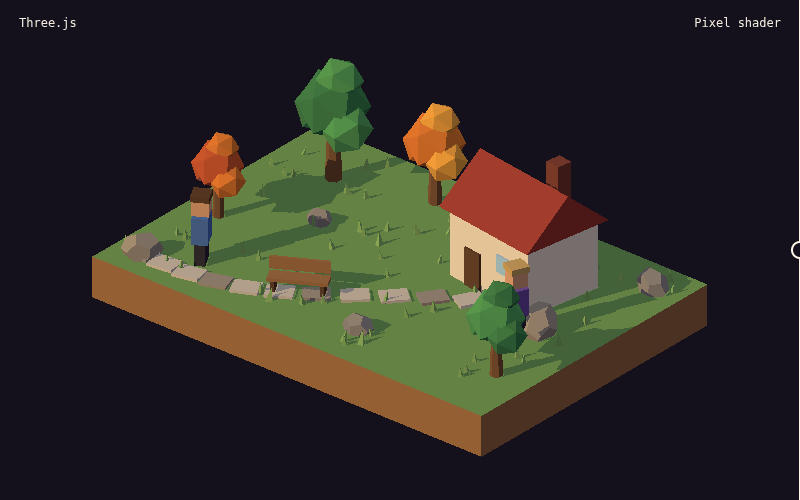

# three-webgpu-pixel-shader



A pixel art post-process for the Three.js `WebGPURenderer`, written in TSL. It renders your 3D scene at a low resolution and snaps the colors to a small palette. It adds an ordered dither, dark outlines, and a warm rim light on the upper-left edges. Every scene pixel becomes a crisp square on the screen. It is one file with no build step.

## Usage

```js
import * as THREE from 'three/webgpu';
import { createPixelPipeline, markSharp } from 'three-webgpu-pixel-shader';

const renderer = new THREE.WebGPURenderer();
await renderer.init();
const pixel = createPixelPipeline(renderer, scene, camera, { pixelSize: 3 });

hero.material = markSharp(new THREE.MeshStandardNodeMaterial({ color: 0x4a6fa5 }));
renderer.setAnimationLoop(() => pixel.render()); // use it instead of renderer.render
pixel.setOptions({ dither: 0.3 });
```

`markSharp` is for characters. A sharp material gets no dither, and its own edge pixels get the outline. It must be a node material.

## Options

| Option | Default | Description |
| --- | --- | --- |
| `enabled` | `true` | `false` gives a normal render with no filter. |
| `pixelSize` | `3` | Screen pixels for each scene pixel, an integer from 1 to 8. |
| `palette` | `'diorama'` | A key of `PALETTES`, a list of hex colors (64 or fewer), or `null` for no color snap. |
| `dither` | `0.15` | The ordered dither strength. 0 is off, 1 is strong. |
| `outlines` | `0.7` | The outline strength. 0 is off, 1 is black. |
| `rim` | `0.35` | The warm rim strength on upper-left edges. 0 is off. |
| `edgeDepth` | `0.0018` | The difference in the depth buffer (0 to 1) that makes an edge. Increase it if flat surfaces get outlines. |

The module also exports `PALETTES`, `hueRamp(base, steps, spread)` to make your own hue-shifted ramps, and `pixel.node` to use the filter output in your own `RenderPipeline`. The demo uses `pixel.node` for the before and after slider.

## How it works

- The scene renders to a target at 1 / `pixelSize` of the screen size. All the filter work runs at this low resolution.
- A depth test against the 4 neighbors finds edges. A pixel just behind an object gets the outline color. An upper-left edge gets the warm rim.
- A 4 x 4 Bayer matrix adds a small offset to each color. Then each pixel snaps to the nearest palette color.
- The 'diorama' palette uses hue-shifted ramps: the shadows move to violet and the lights move to warm yellow.
- A nearest-filter upscale draws each low-resolution pixel as a square block on the screen.

## Demo

Serve the folder with any static server, then open the page:

```sh
python3 -m http.server 8810
```

Drag the divider to compare the plain render with the filter. Add `?auto` to the URL to sweep the divider by itself, or `?webgl` to force WebGL2. The demo loads three from a CDN with an import map.

## Browser support

The filter uses WebGPU where the browser has it. In other browsers, Three.js falls back to WebGL2, and the filter works the same. It needs three r187 or later. WebGPU needs a secure context (`https://` or `localhost`).

## Credit

The visual rules come from [pixel-plays](https://github.com/amirmushichge/pixel-plays) by AmirMushich (MIT). pixel-plays draws with a CPU software rasterizer. This package makes the same look again as a GPU post-process. It contains no code from pixel-plays.

## License

MIT
